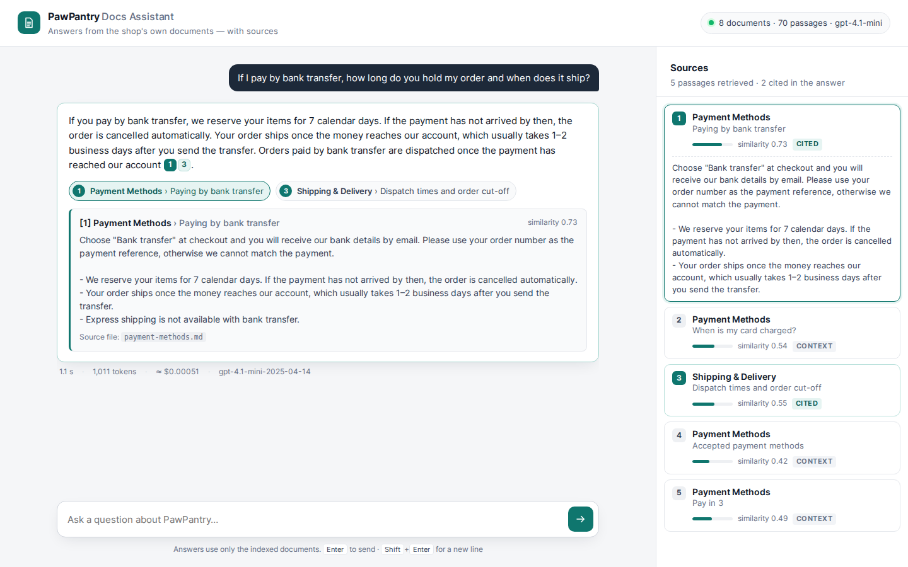
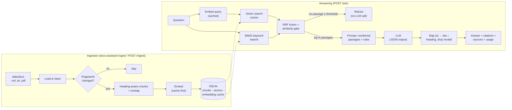
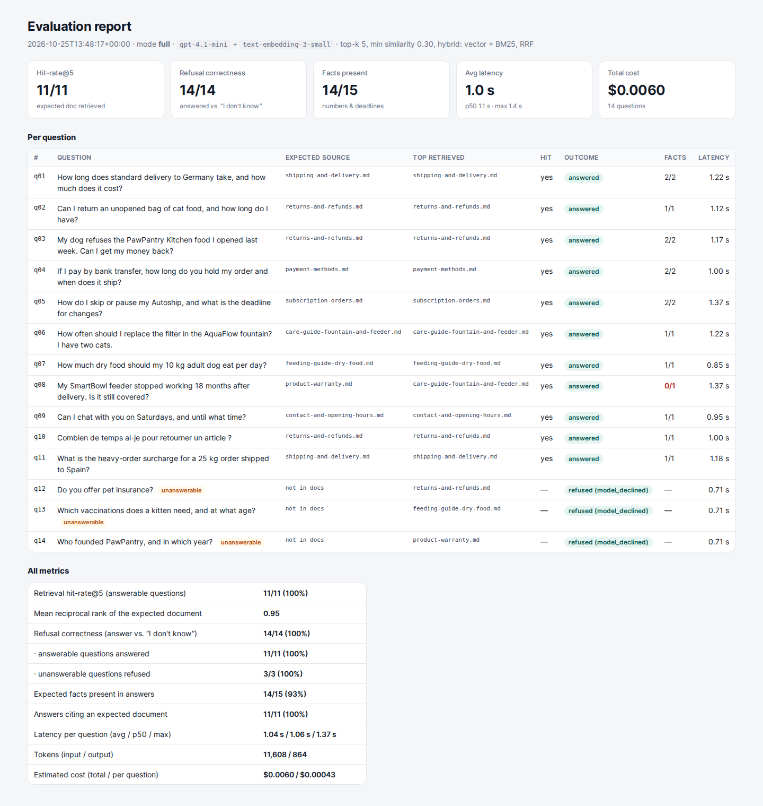
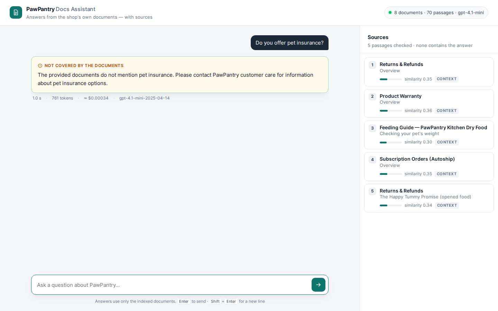

# Docs Assistant — RAG over your own documents

A small, production-minded **retrieval-augmented generation (RAG)** service. It answers customer and staff questions **only from a company's own documents**, cites the exact passages it used, and says **"I don't know based on the documents"** when they don't cover the question.

The demo knowledge base belongs to **PawPantry, a fictional online pet-supplies shop**. The shop, its policies, products, addresses and phone numbers are invented for this demo.



---

## The problem

Shops and service companies keep answering the same questions — delivery times, return windows, payment options, product care — while the answers already exist in their help pages, PDFs and internal docs. A generic chatbot invents plausible but wrong policies. For a business, a confidently wrong answer about refunds or warranty is worse than no answer.

This assistant is built around three rules:

1. **Answer only from the documents.** Retrieved passages are the only facts the model may use.
2. **Show the sources.** The model must cite passages as `[n]`; each marker is mapped to a document and section (invalid numbers are dropped), and the UI shows the passage on click.
3. **Refuse honestly.** If nothing relevant is found, it refuses without calling the LLM at all; if the passages are related but don't contain the answer, the model is instructed to decline — in the user's language.

## Features

- **Ingestion** of Markdown, plain text and PDF (optional `pypdf`), with cleaning (front matter, HTML comments, link/image markup) and **heading-aware chunking** (chunks never cross a heading; long sections split on paragraph/sentence boundaries with a sentence-aligned overlap).
- **Idempotent, incremental indexing**: a per-document fingerprint (content hash + embedding model + chunking settings) means only new or changed files are re-processed; deleted files are removed. An **on-disk embedding cache** keyed by text hash means unchanged passages — and repeated questions — are never embedded twice.
- **SQLite** storage (one file, no server) with NumPy cosine search.
- **Hybrid retrieval**: vector search + BM25 keyword search fused with **reciprocal rank fusion**, behind a **similarity threshold** that acts as a relevance gate.
- **Provider abstraction**: OpenAI implemented and used live (`gpt-4.1-mini`, `text-embedding-3-small`); Anthropic implemented and unit-tested, not run live in this demo. Both use **structured JSON output** (`{"answerable": bool, "answer": str}`).
- **Structured results**: answer, refusal reason, citations (doc, heading, snippet, similarity), every passage given to the model, latency breakdown, token usage and estimated cost.
- **FastAPI** service: `POST /ask`, `POST /ingest` (optionally protected by an admin token), `GET /documents`, `GET /health`, OpenAPI docs at `/docs`, security headers (strict CSP).
- **Single-page chat UI** in vanilla HTML/CSS/JS served by FastAPI (no build step, self-hosted font, no third-party requests): clickable citation chips that expand the source passage, and a sources panel with similarity scores.
- **Evaluation harness** (`python -m docs_assistant.eval`): retrieval hit-rate@k, MRR, refusal correctness, expected facts in the answer, citation correctness, latency and cost, written as Markdown, JSON and a styled HTML page.
- **Quality**: type hints (`mypy` clean), `ruff` clean, 85 tests (79 pytest tests + 6 doctests) using fake providers — **no network access in tests**.

## Architecture



| Module | Responsibility |
|---|---|
| `loaders.py` | Read `.md`/`.txt`/`.pdf`, clean text, split into sections by heading path |
| `chunking.py` | Size-bounded chunks within a section, sentence-aligned overlap |
| `store.py` | SQLite: documents, chunks + vectors, embedding cache, change counter |
| `cache.py` | Embedding cache in front of any provider |
| `ingest.py` | Incremental, idempotent ingestion |
| `retrieval.py` | Vector + BM25 search, reciprocal rank fusion, similarity gate |
| `prompts.py` | System prompt, context formatting, JSON output schema |
| `llm.py` / `embeddings.py` | OpenAI and Anthropic adapters, offline hashing embeddings |
| `answering.py` | The pipeline: retrieve → refuse or generate → map citations |
| `api.py` / `static/` | FastAPI app and chat UI |
| `eval.py` | Evaluation harness and report rendering |

## Evaluation (real run)

14 labelled questions (`eval/questions.yaml`): 11 answerable — including one in French — and 3 that the documents do not answer. Run on 2026-10-25 with `gpt-4.1-mini` and `text-embedding-3-small`, top-k 5, minimum similarity 0.30, hybrid retrieval. Full report: [`eval/report.md`](eval/report.md).

| Metric | Result |
|---|---|
| Retrieval hit-rate@5 (answerable questions) | 11/11 (100%) |
| Mean reciprocal rank of the expected document | 0.95 |
| Refusal correctness (answer vs. "I don't know") | 14/14 (100%) |
| · answerable questions answered | 11/11 (100%) |
| · unanswerable questions refused | 3/3 (100%) |
| Expected facts present in answers | 14/15 (93%) |
| Answers citing an expected document | 11/11 (100%) |
| Latency per question (avg / p50 / max) | 1.04 s / 1.06 s / 1.37 s |
| Tokens (input / output) | 11,608 / 864 |
| Estimated cost (total / per question) | $0.0060 / $0.00043 |



**What the eval caught — and it's worth reading.** Hit-rate is measured per *document*, which is generous:

- **q08** (*"My SmartBowl feeder stopped working 18 months after delivery. Is it still covered?"*) retrieved the warranty document, but not the section that answers it ("Legal guarantee", 2 years). The question's wording is closer to the feeder care guide, and that section did not rank in the top 12. The model did not invent a number: it said the warranty duration was not in the passages it received. That is the safe failure mode, but it is still a miss.
- A question that combines two intents (*"I want to return an unopened bag of dog food. How long do I have, and when do I get my money back?"*) can miss the second section at k = 5: in an offline check against the cached embeddings, "Refund timing" ranked 6th. Raising `TOP_K` to 8 would include it, at roughly +300 input tokens per question (a passage averages ~90 tokens). On the 11 answerable eval questions, section-level recall (with section labels I assigned for this check; they are not yet in `questions.yaml`) was the same 10/11 at k = 5, 6 and 8, so the default stays at 5.

Next steps I would take with real client data: section-level labels in the eval set, query rewriting for vocabulary mismatch, and a re-ranker on the top 20 candidates.

**How the two refusal layers performed.** The similarity gate is a cheap filter for clearly off-topic questions (live check: *"Write me a short poem about the ocean"* was refused with no LLM call, 8 embedding tokens). On-topic questions that the docs don't answer (pet insurance, kitten vaccinations, the founder) score 0.36–0.49, which overlaps with answerable questions (lowest: 0.42). The gate cannot separate those, so the model makes the call — and declined all three correctly.



## Quick start

Requirements: Python 3.11+ and an OpenAI API key.

```bash
python -m venv .venv && source .venv/bin/activate
pip install -e ".[dev]"            # or: pip install -e ".[pdf]" for runtime + PDF only
cp .env.example .env               # then set OPENAI_API_KEY in .env

docs-assistant ingest              # index data/docs (re-runs only process changes)
docs-assistant serve               # http://127.0.0.1:8000  (API docs at /docs)
docs-assistant ask "How long does delivery to Germany take?"

python -m docs_assistant.eval      # writes eval/report.md, .json and .html
python -m docs_assistant.eval --retrieval-only   # retrieval metrics only, no chat calls
python -m docs_assistant.eval --from-json eval/report.json   # re-render reports, no API calls

pytest && ruff check . && mypy     # tests run offline with fake providers
```

**Offline mode:** `EMBEDDING_PROVIDER=hashing` uses a deterministic bag-of-words embedder (no API, no semantics). It is meant for tests and demos without a key; answers still need an LLM provider.

**Docker** (a `Dockerfile` is included; it was not built as part of this demo run):

```bash
docker build -t docs-assistant .
docker run -p 8000:8000 -e OPENAI_API_KEY -v docs-index:/app/var docs-assistant
# serve your own documents instead of the sample set:
#   -v /path/to/your/docs:/app/data/docs:ro
```

## API

### `POST /ask`

```bash
curl -s localhost:8000/ask -H 'Content-Type: application/json' \
  -d '{"question": "If I pay by bank transfer, how long do you hold my order and when does it ship?"}'
```

```jsonc
{
  "answer": "If you pay by bank transfer, we reserve your items for 7 calendar days. ... [1][3].",
  "answerable": true,
  "refused": false,
  "refusal_reason": null,            // or "no_relevant_context" | "model_declined"
  "citations": [
    {"number": 1, "chunk_id": "df89ea2ba2bf2053", "doc_path": "payment-methods.md",
     "doc_title": "Payment Methods", "heading": "Paying by bank transfer",
     "snippet": "Choose \"Bank transfer\" at checkout and you will receive our ...", "similarity": 0.7339},
    {"number": 3, "doc_path": "shipping-and-delivery.md", "heading": "Dispatch times and order cut-off", ...}
  ],
  "sources": [ /* all 5 passages given to the model, numbered 1..5, each with "cited": true/false */ ],
  "model": "gpt-4.1-mini-2025-04-14",
  "latency_ms": {"retrieval": 1.5, "generation": 1136.8, "total": 1138.6},
  "usage": {"input_tokens": 924, "output_tokens": 87, "embedding_tokens": 0, "cost_usd": 0.0005088}
}
```

(Values from the live run behind screenshot 1; long strings are shortened here. Retrieval took 1.5 ms and used 0 embedding tokens because the question's embedding was already cached from the eval run.) Optional field: `"top_k": 1..20`. Validation errors return 422; an upstream provider failure returns 502 with a generic message (provider error details are never echoed to clients).

### `POST /ingest`

```bash
curl -s -X POST localhost:8000/ingest -H "X-Admin-Token: $ADMIN_TOKEN" \
  -H 'Content-Type: application/json' -d '{"rebuild": false}'
```

Returns which files were added / updated / unchanged / removed / skipped and how many embeddings were computed vs. served from cache. The header is required only when `ADMIN_TOKEN` is set. `rebuild: true` re-processes every file; chunks are swapped per document, so the index stays searchable during a rebuild, and the embedding cache keeps it free.

`GET /documents` lists indexed documents; `GET /health` reports index size and models.

## Configuration

All settings are environment variables (see [`.env.example`](.env.example)):

| Variable | Default | Purpose |
|---|---|---|
| `OPENAI_API_KEY` | — | OpenAI credentials |
| `LLM_PROVIDER` / `LLM_MODEL` | `openai` / `gpt-4.1-mini` | Answer model (`anthropic` supported) |
| `EMBEDDING_PROVIDER` / `EMBEDDING_MODEL` | `openai` / `text-embedding-3-small` | `hashing` for offline use |
| `DOCS_DIR` / `INDEX_PATH` | `data/docs` / `data/index.sqlite` | Where documents and the index live |
| `CHUNK_MAX_CHARS` / `CHUNK_OVERLAP_CHARS` | `1200` / `200` | Chunk size and overlap |
| `TOP_K` / `MIN_SIMILARITY` / `HYBRID_SEARCH` | `5` / `0.30` / `true` | Retrieval |
| `MAX_ANSWER_TOKENS` / `TEMPERATURE` | `500` / `0` | Generation |
| `ADMIN_TOKEN` | empty | Protects `POST /ingest` when set |
| `USAGE_LOG_PATH` | empty | JSONL log of tokens and cost per paid call (no prompts, no keys) |

## Adapting it to a client's documents

The pipeline only needs text with headings. Getting a client's content into `DOCS_DIR` (or into a new loader) is usually the main integration work:

| Source | Approach |
|---|---|
| **PDF manuals, price lists, T&Cs** | Drop them in `DOCS_DIR`; each page becomes a section ("Page 3") for citations. Scanned PDFs need OCR first (not included). |
| **WordPress / WooCommerce** | Pull pages, posts and product descriptions from the REST API (`/wp-json/wp/v2/pages`, `/wp-json/wc/v3/products`), convert HTML to Markdown keeping `<h2>/<h3>` as headings, write one `.md` per page. Call `POST /ingest` from a small plugin on the `save_post` hook (or on a schedule) so the index follows edits. |
| **Google Drive / Docs** | Export Docs as Markdown or plain text through the Drive API (files.export), sync a folder on a schedule; the fingerprint skips unchanged files. |
| **Notion** | Read pages through the Notion API and map heading blocks to `#`/`##`; one file per page keeps citations readable. |
| **Help desk / FAQ exports** | One Markdown file per category, one `##` per question. |

Other things that typically change for a real deployment: the company name and refusal wording (`COMPANY_NAME`, `answering.py`), the eval set (20–50 real customer questions with expected sources is enough to catch regressions), authentication and rate limiting on `/ask`, and — beyond tens of thousands of chunks — swapping `store.py` for pgvector or a dedicated vector database behind the same methods.

## Cost notes

Measured on this demo (token counts from the API responses; prices from the table in `usage.py`, which holds list prices at the time of writing — check the provider's pricing page):

- **Ingestion** of the 8 documents (~4,800 words, 70 chunks): 6,469 embedding tokens ≈ **$0.00013**. Re-ingesting unchanged files costs nothing (no API calls).
- **One answered question**: ~830 input + ~62 output tokens with `gpt-4.1-mini` ≈ **$0.0004**, so about **$0.43 per 1,000 questions**. With `gpt-4o-mini` the same token counts would cost about 2.7× less (not measured in this run).
- **Gate refusals** (off-topic questions) cost only the query embedding (~$0.0000002).
- Repeated questions reuse the cached query embedding; the answer itself is not cached (add a response cache if your traffic is very repetitive).

## Limitations

- Single-turn: follow-up questions are not rewritten using the conversation history.
- Hit-rate in the eval is document-level; see "What the eval caught" above.
- The language detection for the canned refusal message is a small stopword vote (EN/FR/DE/ES/IT/NL); generated answers follow the question's language via the model.
- The Anthropic adapter is unit-tested against a stub client but was not exercised live here.
- No authentication or rate limiting on `/ask` in this demo; add both before exposing it publicly.

## Project layout

```
src/docs_assistant/   application package (see the module table above)
  static/             chat UI (index.html, app.css, app.js), eval report CSS, Inter font (OFL)
data/docs/            fictional PawPantry knowledge base (8 Markdown documents)
eval/                 questions.yaml + report.md / report.json / report.html from the live run
tests/                pytest suite (fake embedding and LLM providers, no network)
assets/screenshots/   screenshots from the live run
```

## License

[MIT](LICENSE) © 2026 Aleks T. The bundled Inter font is licensed under the SIL Open Font License (`src/docs_assistant/static/fonts/LICENSE-inter.txt`).
